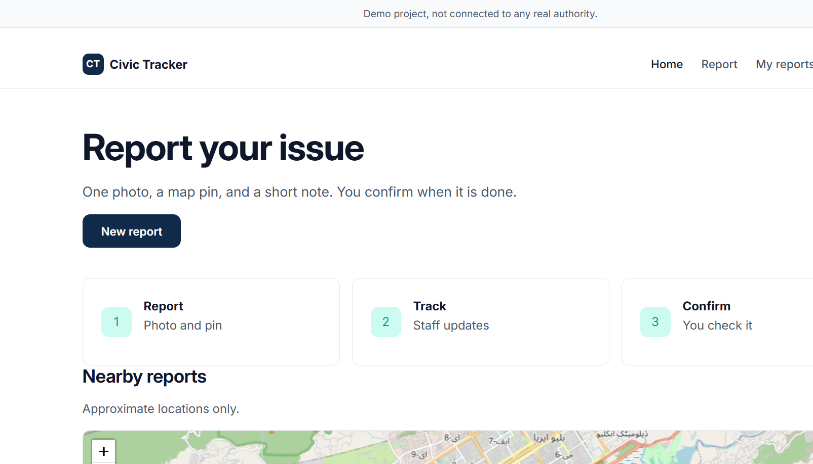
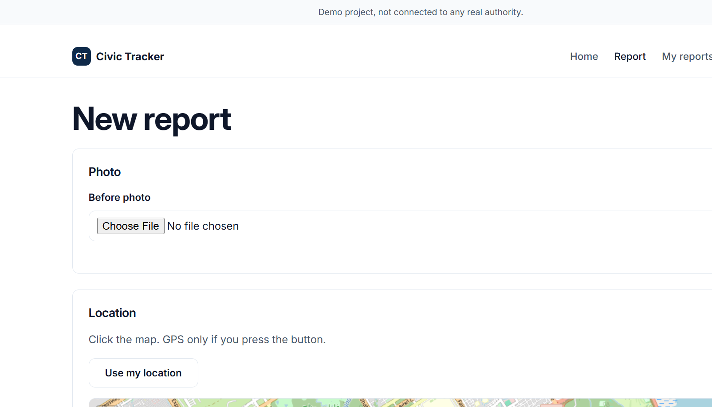
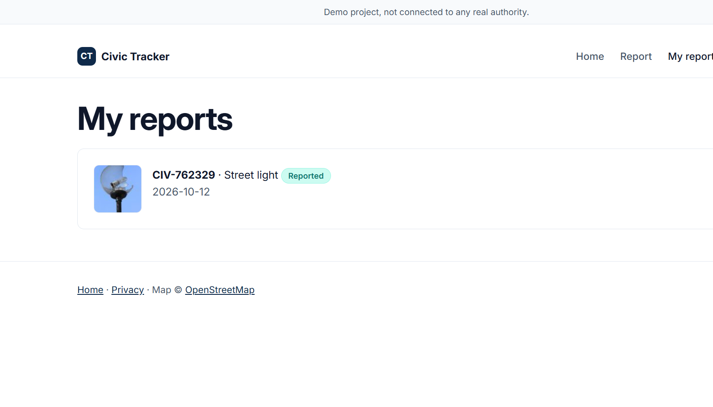
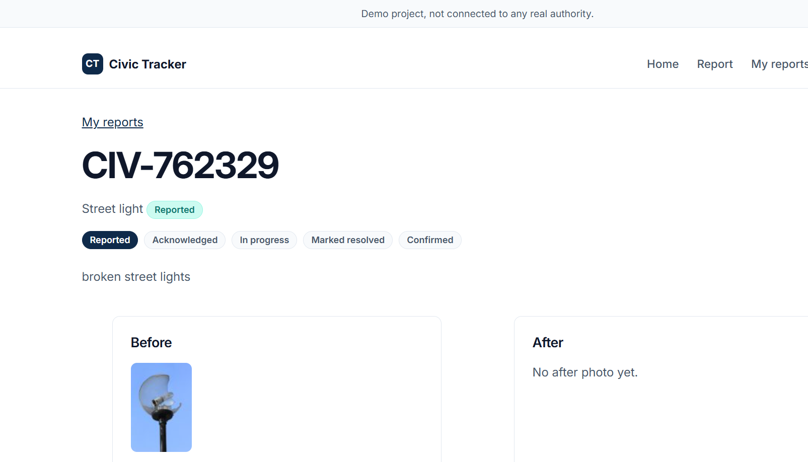

# Civic Issue Tracker

Civic Issue Tracker is a beginner-friendly Flask web app for reporting local problems (potholes, garbage, street lights, water, other). A resident uploads a photo, drops a map pin, and gets a tracking ID. Staff in the matching department work that queue. The same citizen can confirm a fix or reopen the ticket. Maps use Leaflet and OpenStreetMap. Photos stay in `instance/uploads`, not a public static folder.

**This is a demo project, not connected to any real authority.**






Mobile captures also live in `docs/screenshots/` (`*-375.png`).

**Demo video:** [docs/demo-video/civic-issue-tracker-demo.gif](docs/demo-video/civic-issue-tracker-demo.gif) (home → report form → my reports → detail). Rebuild with `python scripts/make_demo_video.py`.

---

## About the project

| | |
|---|---|
| Stack | Flask 3, Flask-Login, SQLAlchemy, Flask-Migrate, Flask-Limiter, Pillow, SQLite |
| Maps | Leaflet + OpenStreetMap tiles (no Google Maps) |
| Auth | Email/password; optional Google sign-in for **citizens only** (Firebase) |
| Photos | JPEG stored locally, EXIF stripped, login-only download |
| Hosting notes | See [DEPLOY.md](DEPLOY.md) (PythonAnywhere, Render, Fly) |

A `.gitignore` is already in the repo root. It ignores `.env`, `instance/`, uploads, `*.db`, `.venv*`, `__pycache__`, and service-account JSON so secrets and local data do not go to GitHub.

---

## How to use

### 1. Install (Windows)

```bash
python -m venv .venv
.venv\Scripts\activate
pip install -r requirements.txt
copy .env.example .env
```

Edit `.env`:

- `SECRET_KEY` — long random string (never the example placeholder)
- `STAFF_EMAIL` / `STAFF_PASSWORD` — first staff login
- Optional: department emails, SMTP, Firebase names (see `.env.example`)

### 2. Run locally

```bash
set FLASK_APP=run.py
set APP_ENV=development
flask db upgrade
python run.py
```

Open http://127.0.0.1:5000  
Debug stays off unless `FLASK_DEBUG=1`.

### 3. Optional demo data

```bash
flask seed-demo
```

Runs only when `APP_ENV=development` or `DEMO_MODE=true`. It creates `@example.test` users and 50+ sample issues using labelled JPEGs in `app/static/demo/`. **Passwords print in that terminal only** — copy them; they are not written to files.

### 4. Two-browser walkthrough (citizen + staff)

Use two browser profiles (or one normal window and one private window).

1. Seed as above. Copy `citizen@example.test` and `roads@example.test`.
2. **Citizen profile:** log in, submit a pothole. If a similar report exists nearby, choose **I'm affected too** or **This is a different issue**.
3. **Staff profile:** log in as Roads staff. The queue is Roads only. Set in progress, then mark resolved with an after photo.
4. Back in the citizen profile: confirm or reopen. `admin@example.test` can see every department.

Or register a real citizen from `/register` and log in as the env staff user (`STAFF_DEPARTMENT`, default Other).

### 5. Tests

```bash
pytest
pytest -v
```

### 6. Useful CLI

| Command | What it does |
|---|---|
| `flask db upgrade` | Apply migrations |
| `flask seed-demo` | Fake users + 50+ demo issues |
| `flask auto-confirm` | Confirm old “marked resolved” tickets after `AUTO_CONFIRM_DAYS` (default 7) |
| `flask find-orphan-uploads` | List photo files with no database row |
| `flask backfill-thumbnails` | Write missing thumbs |

Optional staff recreate: `python scripts/seed.py`.

### Render

Python 3.12. Build `pip install -r requirements.txt`. Start `sh scripts/start.sh`. Health check `/`. Set `STAFF_EMAIL`, `STAFF_PASSWORD`, and `STAFF_DEPARTMENT`. The blueprint supplies `SECRET_KEY`. A free Render instance cannot keep the SQLite file. Other hosts and the longer steps are in [DEPLOY.md](DEPLOY.md).

---

## Feature working flows

### Home and public map

Anyone can open `/`. The hero is **Report your issue**. **Nearby reports** shows rounded, opt-in pins only (category + status, no name, no tracking ID). **Recently fixed** uses only labelled DEMO images from `app/static/demo/`, never live citizen photos.

### Register / login / account

- Citizen registers with email, password, and privacy consent. The saved address is trimmed and lower case, so a later login with different spacing or capitals still matches.
- Staff is created from `.env` (`STAFF_EMAIL`) or from `flask seed-demo`.
- Optional **Continue with Google** on login (citizens only). Staff never get a staff role from Google.
- Account page: log out, or delete account (password or recent Google re-auth). Deletion removes that user’s issues, photos, and `issue_supporters` rows.

### New report (citizen)

1. Log in → **Report**.
2. Photo (JPEG/PNG/WebP), map pin, category, description (10–1000 chars), consents.
3. GPS runs only after **Use my location**. File GPS is stripped from the photo.
4. Stage 1 quality check (resolution, blur, brightness, dHash). Unreadable / tiny / near-black or white photos are rejected. Blurry or similar-to-another-user photos can be accepted with **needs review**.
5. Duplicate rule: same category, within `DUPLICATE_RADIUS_M` (default 40 m), not Confirmed, created within `DUPLICATE_DAYS` (default 30).
   - Match card shows category, status, and **very close** / **within 100 m** only — no ID, exact metres, coordinates, or reporter.
   - **I'm affected too** adds a unique supporter row (no new ticket). You cannot support your own issue twice.
   - **This is a different issue** creates a ticket with a possible-duplicate badge.
6. Success: tracking ID (`CIV-…`). New reports are limited to 10 POSTs per minute per user.
7. If a department email is configured, a plain-text notice is sent in the background (never blocks the report).

### My reports and citizen detail

Paginated list of that citizen’s tickets. Detail: status stepper, before/after photos, confirm (when allowed) or reopen with a note (and optional extra photo).

### Staff queue

Staff belong to one department (Roads, Sanitation, Water, Electric, Other) mapped from category. They see only that queue. **Admin** sees all. Wrong-department issue or photo URL → **404**. Queue shows supporter count, possible-duplicate badge, and needs-review badge. Staff can clear the review flag. Marking resolved requires an after-repair photo.

Statuses (typical path): reported → acknowledged → in progress → marked resolved → confirmed. Citizen may reopen from marked resolved.

### Department email

On a successful **new** ticket (not seed, unless `EMAIL_FOR_DEMO=true`), email goes to the mapped inbox:

`DEPT_EMAIL_ROADS`, `DEPT_EMAIL_SANITATION`, `DEPT_EMAIL_WATER`, `DEPT_EMAIL_ELECTRIC`, `DEPT_EMAIL_OTHER`

Body: tracking ID, category, description (max 300 chars), OSM map link, staff login URL. **No** reporter email/name/uid, **no** photo.

- `EMAIL_BACKEND=console` (default in development) prints in the terminal.
- `EMAIL_BACKEND=smtp` uses `SMTP_HOST`, `SMTP_PORT`, `SMTP_USER`, `SMTP_PASSWORD`, `SMTP_FROM`, `SMTP_TLS`.

Use **your own** inboxes for tests.

**Gmail:** Account → Security → 2-Step Verification → App passwords. `SMTP_HOST=smtp.gmail.com`, port `587`, TLS on, password = the 16-character app password.

**Brevo:** SMTP key from the dashboard. Typical host `smtp-relay.brevo.com`, port `587`.

Failures are logged as a generic line (no addresses, no coordinates) and never fail the report.

### Photo quality (Stage 1)

Pillow only, no CLIP. Checks a downscaled grayscale copy: min edge, Laplacian-style blur, mean brightness, perceptual dHash. Same user uploading a near-identical photo is rejected; another user’s similar photo is flagged for review. `PHOTO_AI_ENABLED` is a placeholder and is not implemented. Evaluate a folder: `python scripts/eval_photos.py path\to\folder` (prints “No photos supplied.” if empty).

### Privacy (matches `/privacy`)

- Photos: reporter or **same-department** staff (admin: all). Not under `/static`.
- Public map: rounded coordinates, opt-in only.
- CSRF on POST; rate limits on login and new reports; CSP and related headers.
- Do not commit `.env` or `instance/`.

### Google sign-in (optional)

Set `FIREBASE_PROJECT_ID`, `FIREBASE_WEB_API_KEY`, `FIREBASE_AUTH_DOMAIN`, and `GOOGLE_APPLICATION_CREDENTIALS` (JSON **outside** the repo). Add authorized domains in the Firebase console. Never set `FIREBASE_AUTH_EMULATOR_HOST` in production. Tests mock Google and do not call the network.

---

## Folder structure

```
Civic_Issue_Tracker/
  app/
    __init__.py          # Flask factory, security headers, CLI
    config.py            # Env-driven settings
    models.py            # User, Issue, photos, supporters, events
    blueprints/          # public, auth, citizen, staff routes
    services/            # issues, images, duplicates, seed, email, photo_check
    templates/           # Jinja pages (public, citizen, staff, auth, errors)
    static/              # css, js, vendor (Leaflet, Firebase), demo/*.jpg
  migrations/            # Flask-Migrate / Alembic
  tests/                 # pytest
  scripts/               # start.sh, seed helpers, eval_photos.py
  docs/screenshots/      # UI captures
  instance/              # SQLite + uploads (gitignored)
  .env.example           # Names only; copy to .env (gitignored)
  .gitignore
  .python-version        # 3.12
  render.yaml            # Render blueprint
  run.py                 # Local http://127.0.0.1:5000; binds 0.0.0.0:$PORT when PORT is set
  wsgi.py                # Production app object (no server of its own)
  requirements.txt
  DEPLOY.md
  README.md
```

---

## Future improvements

- Real department accounts and an official case-management handoff (this demo is not that).
- PostgreSQL or another hosted database instead of SQLite on a sleeping free host.
- Object storage for photos so uploads survive VM restarts.
- Shared rate-limit storage (Redis) for multiple workers.
- CLIP or a similar model behind `PHOTO_AI_ENABLED` (not implemented).
- Hamming search in the database instead of loading all dHashes.
- Multi-worker duplicate detection beyond SQLite `BEGIN IMMEDIATE`.
- SMS or in-app notifications in addition to department email.
- Proper HA / backups if this were ever used with real civic data.

---

## Privacy (short)

Do not commit `.env` or `instance/`. Photos are login-only. The public map has no names, emails, tracking IDs, or photos. Free hosts often wipe SQLite and uploads when the instance sleeps.

---

## Tests

```bash
pytest -v
```

This app was created using Cursor.
